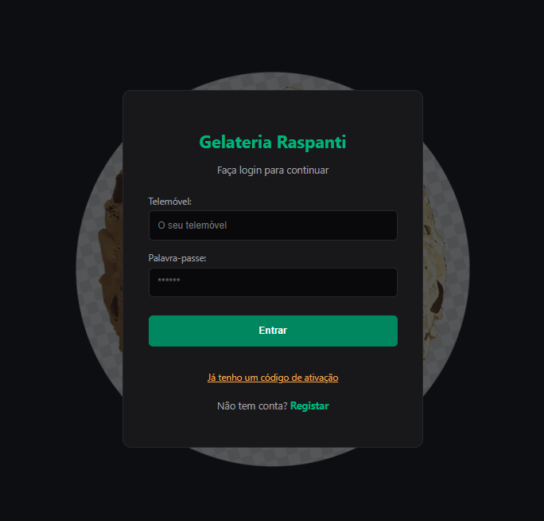

# 🍨 Gelateria Raspanti
> Sistema de gestão completo para uma gelateria artesanal, desenvolvido com arquitetura moderna e separação clara entre Backend e Frontend.

<p align="center">
  
  
  
  
  
</p>

---

## 📋 Sobre o Projeto

A **Gelateria Raspanti** é uma aplicação full-stack desenvolvida para gerir o ecossistema completo de uma gelateria, englobando controlo de estoque em tempo real, painel de vendas (PDV), e-commerce para clientes com histórico de compras e um painel administrativo analítico com rankings de desempenho.

---

## 🚀 Tecnologias Utilizadas

### **Backend**
* **Java 17+** / **Spring Boot 3.x**
* **Spring Security** (Autenticação Básica e Controlo de Papéis / Roles)
* **Spring Data JPA / Hibernate**
* **PostgreSQL**

### **Frontend**
* **React** com **Vite**
* **Axios** (Integração REST API)
* **CSS Personalizado** (Tema escuro unificado com identidade visual em tons de pistache)

---

## 🗺️ Mapa Funcional e Transição de Telas

O fluxo de navegação adapta-se automaticamente com base no papel (*role*) e no estado da conta do utilizador:

```text
[ Acesso à Aplicação ]
       │
       ├─► [ Registo de Nova Conta ] ──► [ Envio de Código SMS (Simulado) ] ──► [ Ativação de Conta ]
       │                                                                                 │
       └─► [ Login de Utilizador ] ──────────────────────────────────────────────────────┘
                   │
                   ├─► ROLE_ADMIN / ROLE_GERENTE ──► [ Painel Administrativo / Gestão ]
                   ├─► ROLE_VENDEDOR             ──► [ Painel PDV / Vendas ]
                   └─► ROLE_CLIENTE              ──► [ Portal do Cliente / Cesta e Compras ]
````
📸 Demonstração Visual do Sistema

🔐 1. Autenticação, Registo e Ativação
![Login] 
![AutoRegister] ![Auto Register Page] (AutoRegisterPage.png) 
![ActivatePage] ![Activate Page] (ActivatePage.png)  

⚙️ 2. Painel Administrativo e Gestão (Manager / Admin)
Gestão completa de funcionários, catálogo de produtos, stock em tempo real e relatórios de desempenho.

![DashboardGerenteCadastraFuncionarioOuProduto] ![Dashboard Gerente Page - Cadastro Produto/Funcionario] (DashboardGerenteCadastraFuncionarioOuProduto.png)
![DashboardGerenteEditaFuncionarioOuProduto] ![Dashboard Gerente Page - Edita Produto/Funcionario] (DashboardGerenteEditaFuncionarioOuProduto.png)
![DashboarGerenteRakingDesempenhoPorPeriodo] ![Dashboard Gerente Page - Ranking e Desempenho por período] (DashboarGerenteRakingDesempenhoPorPeriodo.png)

🛒 3. Portal do Cliente e E-commerce
Cardápio interativo, adição rápida de gelatos à cesta, checkout simulado e histórico de compras atualizado.

![ClientePageSemCompraCarrinhoVazio] ![Página do Cliente - Sem compra e histórico de compras] (ClientePageSemCompraCarrinhoVazio.png)
![ClientePageItensNoCarrinho] ![Página do Cliente - Itens no carrinho] (ClientePageItensNoCarrinho.png)
![ClientePageCompraRealizadaComHistoricoDisponivel] ![Página do Cliente - Compra realizada com histórico] (ClientePageCompraRealizadaComHistoricoDisponivel.png)


⚙️ Como Executar o Projeto Localmente
Certifique-se de ter o Java 17+, Node.js e o PostgreSQL instalados na sua máquina.

1. Clonar o Repositório

git clone [https://github.com/seu-utilizador/gelateria-raspanti.git](https://github.com/seu-utilizador/gelateria-raspanti.git)
cd gelateria-raspanti

2. Configurar a Base de Dados
Crie uma base de dados no PostgreSQL com o nome gelateria_raspanti e ajuste as credenciais no ficheiro backend/src/main/resources/application.properties, se necessário.

3. Executar o Backend
cd backend
./mvnw spring-boot:run

4. Executar o Frontend
cd frontend
npm install
npm run dev

✒️ Autor
Desenvolvido por Lucas Vieira. Sinta-se à vontade para contribuir ou entrar em contacto!